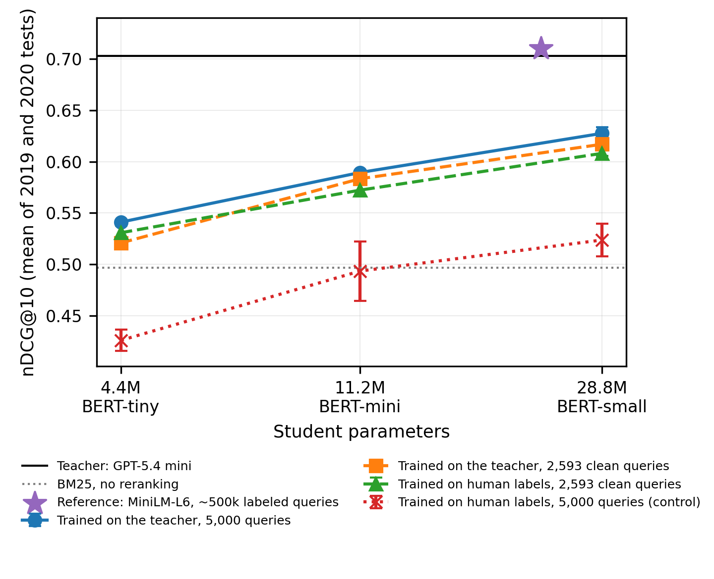

# The Apprentice Model

How small can a distilled LLM reranker be? NLP course project (P6), Università degli Studi di Milano, 2025/26.

GPT-5.4 mini, used as a listwise reranker (RankGPT-style prompt), ranks the BM25 candidates of 5,000 MS MARCO
training queries. That cost $8.19. Its rankings are then used to train three small BERT cross-encoders
(4.4M, 11.2M and 28.8M parameters), and I compare them with the same students trained on the human labels
of the same queries. Every system reranks the same BM25 top-100 on TREC DL 2019 and 2020.

Report: [Sheikh Soltani Report.pdf](Sheikh%20Soltani%20Report.pdf), slides: [Sheikh Soltani NLP project.pdf](Sheikh%20Soltani%20NLP%20project.pdf)

## Questions

1. How much of the teacher's quality do 4-29M parameter students keep, and how much faster are they?
2. Is the teacher's ranking a better training signal than the human labels of the same queries?

## Results

nDCG@10 on DL19 / DL20, students averaged over 3 seeds.

| Reference points | Training queries | DL19 | DL20 |
|---|---:|---:|---:|
| BM25, no reranking | - | .511 | .483 |
| Teacher: GPT-5.4 mini (sliding window 30, step 15) | - | .727 | .679 |
| Reference: `cross-encoder/ms-marco-MiniLM-L6-v2` (22.7M) | ~500k | .740 | .680 |

| Student trained on | Queries | BERT-tiny (4.4M) | BERT-mini (11.2M) | BERT-small (28.8M) |
|---|---:|---:|---:|---:|
| **teacher rankings** | 5,000 | **.578 / .504** | **.619 / .560** | **.652 / .603** |
| teacher rankings, clean queries only | 2,593 | .552 / .490 | .607 / .560 | .636 / .598 |
| human labels, clean queries only | 2,593 | .549 / .512 | .596 / .549 | .631 / .585 |
| human labels, then teacher rankings | 5,000 | .561 / .491 | .614 / .543 | .645 / .587 |
| human labels (control) | 5,000 | .470 / .382 | .546 / .441 | .574 / .474 |
| teacher-trained, % of the teacher | | 77% | 84% | 89% |

Clean queries are the ones where BM25 found the labeled passage by itself. For the other 48% the labeled
passage was added in place of the 30th candidate.



- Students trained on the teacher get better with size (77%, 84%, 89% of the teacher). All of them beat BM25,
  none of them reaches the teacher.
- On the same clean queries, teacher rankings and human labels give almost the same students
  (at most 0.011 apart over the 97 test queries, in both directions). The advantage of the teacher is that
  it needs no labels.
- The control students (human labels, all 5,000 queries) fall below BM25 on DL20. Training them only on
  the clean queries brings them back up (+.08 to +.11 over the 97 test queries). Students trained on the teacher's ranking of the
  same lists don't have this problem.
- The teacher needs about 15.7 s and $0.019 per query (6 API calls one after another). The students rerank
  the same 100 passages on a laptop, 25 to 425 times faster (Apple M3, mean over 20 DL19 queries,
  `results/latency.json`):

| Model | Params | CPU, ms/query | MPS, ms/query | Faster than the teacher (CPU / MPS) |
|---|---:|---:|---:|---:|
| BERT-tiny | 4.4M | 63 | 37 | 250x / 425x |
| BERT-mini | 11.2M | 243 | 103 | 65x / 153x |
| BERT-small | 28.8M | 636 | 239 | 25x / 66x |
| MiniLM-L6 (reference) | 22.7M | 631 | 223 | 25x / 70x |
| BERT-base (not trained, just for scale) | 109.5M | 3513 | 1425 | 4x / 11x |

The full table with all sizes and conditions is in `results/summary.json` (`python scripts/08_analyze.py`).

## Repository

```
src/
  retrieval.py              BM25Retriever (bm25s) and build_index
  data.py                   MS MARCO queries and labels, positive injection
  teacher.py                LLM reranker: prompt, parser, cache, sliding window, Batch API
  student.py                cross-encoder, the two losses, training, reranking, evaluation
scripts/                    run them in order from the repo root
  01_build_index.py         BM25 index over 8.8M passages (~30 min, 2.2 GB, once)
  02_make_candidates.py     BM25 top-100 for DL19/DL20/val, top-30 for 5000 train queries
  03_teacher_pilot.py       choosing the teacher: nano / mini / full on 124 val queries
  04_teacher_eval.py        teacher on the test sets
  05_teacher_train_batch.py teacher rankings for training: prepare | submit | status | collect
  06_export_student_data.py training and evaluation files with the passage texts
  07_train_students.py      all students, 3 seeds, all conditions + reference model (~12 h on M3)
  08_analyze.py             table and figure (needs only results/)
  09_latency.py             ms per query on CPU / MPS
notebooks/01_demo.ipynb     short tour: results, teacher prompt and parser, losses, a small training run
colab/run_base.ipynb        BERT-base on a Colab GPU (does not fit in 16 GB on MPS)
cache/teacher/              every teacher answer (raw text, parsed order, tokens)
data/train_candidates.jsonl the 5000 training queries with their 30 candidates
results/runs/               run files {qid: {doc_id: score}} for every system and seed
results/qrels.json          relevance labels for val / DL19 / DL20
```

## Reproducing

```bash
python -m venv .venv && source .venv/bin/activate
pip install -r requirements.txt
echo "OPENAI_API_KEY=sk-..." > .env    # only for steps 03-05
```

| What | Command | Needs |
|---|---|---|
| Table and figure | `python scripts/08_analyze.py` | nothing, uses `results/` |
| Index and candidates | `python scripts/01_build_index.py && python scripts/02_make_candidates.py` | ~10 GB of disk, ir_datasets downloads MS MARCO |
| Teacher (pilot, test, train) | `python scripts/03_teacher_pilot.py`, `04_teacher_eval.py`, `05_teacher_train_batch.py collect` | answers are read from `cache/teacher/`, no API calls |
| Training data | `python scripts/06_export_student_data.py` | steps 01-02 |
| Students | `python scripts/07_train_students.py` | GPU or MPS, finished runs are skipped |
| Latency | `python scripts/09_latency.py` | - |

Reasoning models don't take a temperature, so the teacher is not deterministic. That is why every answer is
cached and included here. Student runs are seeded.

API cost of the whole project: about $14.7 (pilot $2.2, training labels $8.19 with the Batch API discount,
test sets $4.35).
